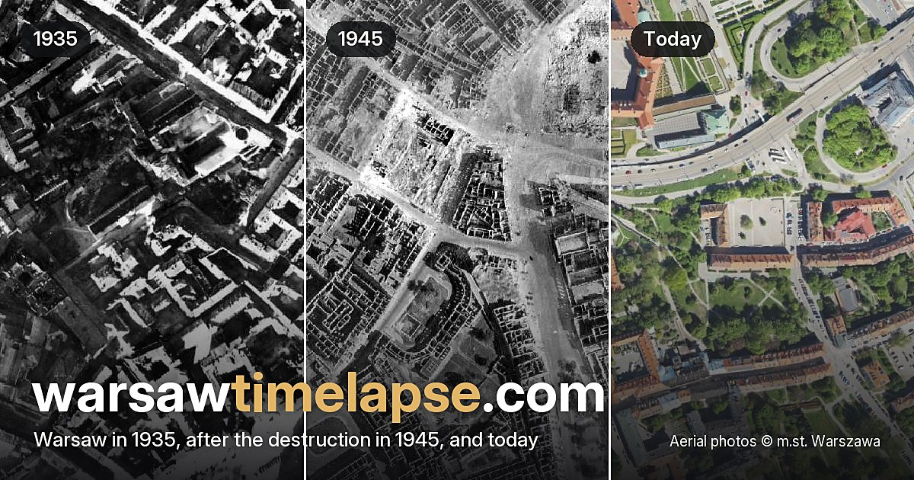
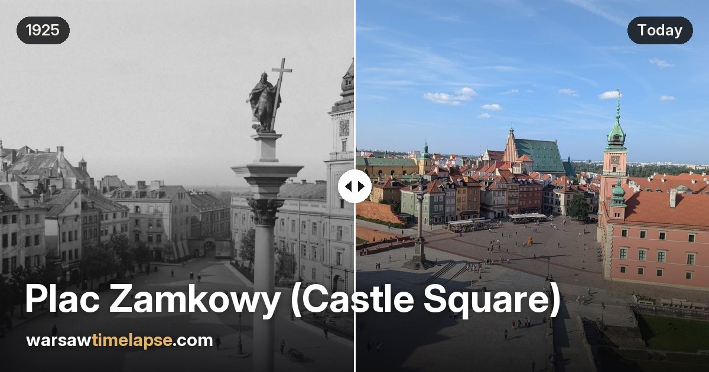
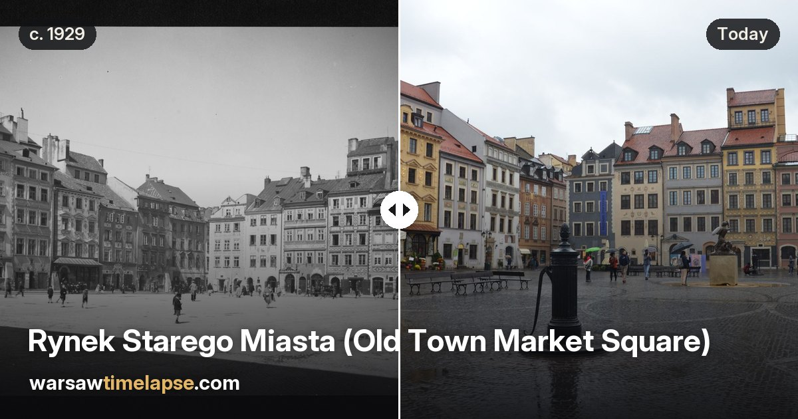
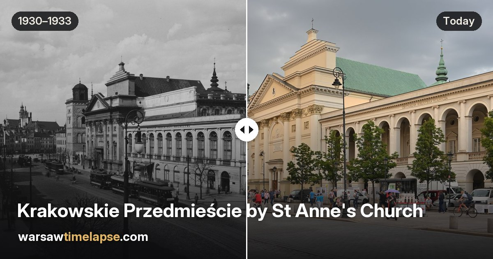
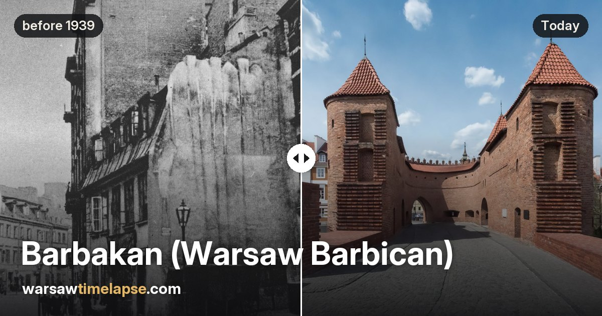

<div align="center">


# Warsaw Timelapse

**Warsaw from the air in 1935, in ruins in 1945, and every decade of rebuilding since.**

Drag a slider across almost a century of aerial photographs, and open pins with street-level photos of the same place before the war and today.

[](https://warsawtimelapse.com)
[](https://warsawtimelapse.com/pl)
[](LICENSE)
[](CONTRIBUTING.md)

[**Open the map**](https://warsawtimelapse.com) · [Add a place](CONTRIBUTING.md) · [Report an issue](https://github.com/Nalhin/warsaw-timelapse/issues)

<br />

<a href="https://warsawtimelapse.com"></a>

</div>

## Why

The goal of the project is to raise awareness of what Poland has been through as a country, and of what
it has achieved since. In 1945 most of Warsaw lay in ruins. Putting the city before the war, right after
it, and today side by side shows both the scale of the loss and the scale of the rebuilding.

## Then and now

<table>
  <tr>
    <td><a href="https://warsawtimelapse.com/spots/plac-zamkowy"></a></td>
    <td><a href="https://warsawtimelapse.com/spots/rynek-starego-miasta"></a></td>
  </tr>
  <tr>
    <td><a href="https://warsawtimelapse.com/spots/krakowskie-przedmiescie"></a></td>
    <td><a href="https://warsawtimelapse.com/spots/barbakan"></a></td>
  </tr>
</table>

## Features

- 🛩️ **28 aerial surveys**: 1935, 1945, 1951 and every later survey up to today, served live from the City of Warsaw's WMS
- ↔️ **Compare mode**: drag a vertical or horizontal divider between any two years
- ▶️ **Timelapse**: play through every year, preloading the next one so each switch is instant
- 📍 **Places**: pins with street-level photos from different decades, all of them originals with author and licence
- 🖼️ **Share images**: export the current view as a split, side-by-side or stacked image sized for social media
- 🔗 **Shareable URLs**: position, zoom, years and the open place all live in the URL
- 🇬🇧 🇵🇱 **English and Polish**, server-rendered place pages with Open Graph previews and JSON-LD

## Quick start

```bash
npm install
npm run dev          # http://localhost:3000
npm run typecheck
npm run build        # static pages for / and every /spots/<id>
```

**Stack:** Next.js 16 (App Router), React 19, TypeScript, Tailwind CSS v4, [shadcn/ui](https://ui.shadcn.com) (Radix), Leaflet via react-leaflet.
The photo pipeline is Python (uv, Pillow; PyTorch and kornia only for `align.py`). The site is statically generated and deployed on Vercel.

## Contributing

Contributions are open and welcome, especially **new places with a pre-war photo and a matching photo from
today**. See [CONTRIBUTING.md](CONTRIBUTING.md) for how to add a place and the rules for photos.

## How it works

<details>
<summary><b>🗺️ The map</b></summary>

- Aerials come from the city WMS `https://mapa.um.warszawa.pl/mapviewer/wms` (WMS 1.1.1, `DATASOURCE=dane_wawa`,
  EPSG:3857, 512 px tiles). The app uses these years: 1935 (`FOTOPLAN_1935`),
  1945 (`ORTOFOTO_1945`), 1951 (`ZDJECIA_1951`), 1972 (`ZDJECIA_1972`), 1976–77, 1982, 1987 and 1990–94
  (`FOTOSZKIC_*`), 1997 (`ZDJECIA_1997`), 2001, 2005, 2008, 2010, 2013 and 2022–2024 (`ORTOFOTO_*`), 2011,
  2012 and 2014–2021 (`FOTOPLAN_*`) and today (`ORTOFOTO_2025`). The city's own map also has 1964 and 1969
  (`SATELITA_*`), but those satellite scans are too blurry at street zoom, so they're left out. The spans 1976–77 and 1990–94 use the keys `1976` and `1990`. Years are defined in
  `src/lib/years.ts`. To add one, add it to `YEARS` and to `LAYERS` in `pipeline/coverage.py`, then run
  `uv run python coverage.py <key>`.
- If 3 tiles fail before any succeeds, the app switches to the official `https://wms.um.warszawa.pl/serwis`
  (`RASTER_FOTOPLAN_*` and `RASTER_ORTOFOTO_*` for 1935, 1945, 2005–2021, and `ORTO` for today). 1951–2001 and
  2022–2024 aren't on that server, so they stay on the primary one. See `src/lib/wms.ts`.
- When you switch years, the new layer loads on top of the old one. The old layer is removed only after the
  new one has finished, so the map never goes blank. A progress bar and a "Loading aerial photos…" pill
  show while tiles load.
- **Play** (the first button in the bar) goes through every year in turn, holding each for 2 s once its tiles
  have loaded. While it plays, the next year loads ahead as an invisible layer under the current one and is
  shown as soon as its turn comes, so the switch is instant (`ahead` in `src/components/map/year-layer.tsx`).
- **The map opens in compare mode** (1945 | Today). The divider can be dragged with a mouse or touch. Each
  side has its own year menu (it scrolls when it doesn't fit), and ⇄ swaps the sides. "One year" leaves compare mode and shows ‹ year › arrows that step through the years, and the last button
  ("Horizontal"/"Vertical", icon only on phones) switches the divider between vertical (the default) and
  horizontal. It clips two Leaflet panes, so there's no plugin
  (`src/components/map/swipe-divider.tsx`).
- **Places** are pins with photos from different years. A pin shows a crop of the photo closest to the year on
  the map, and fades when the place has no photo within 12 years of it. Modern landmarks have square pins.
  Opening one slides in a panel next to the map (a bottom sheet on mobile) with the photo nearest to the map's
  year. In compare mode, both the pin and the panel use the year on the side of the divider the place is on, and
  switch when the divider or the map moves the place across. The arrows and the strip of thumbnails go through every photo of the
  place. Esc closes the panel.
- The buttons on the right, top to bottom: Share, map layers, my location, zoom in and zoom out (zoom is hidden
  on phones). The layers menu turns street names (City of Warsaw WMS labels) and places on and off; with
  places off, the open one stays.
- The map keeps its position and zoom in the URL (`?at=lat,lng,zoom`, updated after every move), so any
  address bar URL is a shareable link to the same view.
- **Share** (the top button on the right) makes an image of the current view for social media: two years
  split at the divider exactly as on the map (default), side by side, or stacked, at the shape of the
  visible map ("Screen", 1600 px on the long side), square (1080×1080), portrait (1080×1350) or landscape
  (1600×900), as a JPEG with an optional title, year tags, a caption and the City of Warsaw credit. Each year is
  requested from the WMS as one GetMap image at the output size (the servers send CORS headers, so the canvas
  can be exported). The split follows the divider orientation. The image is captioned "Warsaw, Poland" and
  the site's domain. The 1945 white padding and the coverage edge fade are applied the same way as on the map.
  The dialog also has the link to the view, and Download, Copy image (desktop) or Share (mobile, via the
  system share sheet). See `src/lib/snapshot.ts` and `src/components/share-dialog.tsx`.

</details>

<details>
<summary><b>🔗 URLs and SEO</b></summary>

| URL | |
|---|---|
| `/` | compare mode, 1945 \| today (default) |
| `/?year=1945` | one year (`1935`, `1945`, … `2024`, `today`; see `YEAR_KEYS` in `src/lib/years.ts`) |
| `/?compare=1945-today` | compare mode, left and right |
| `/?divider=h` | compare mode with a horizontal divider (top and bottom); vertical is the default |
| `/?timelapse=1935` | timelapse, starting at that year |
| `/?at=52.2479,21.0136,17` | map position and zoom (`lat,lng,zoom`); combines with every other URL |
| `/spots/plac-zamkowy` | a place: its own server-rendered page (can be combined with `?compare=` / `?year=`) |
| `/pl`, `/pl/spots/plac-zamkowy` | the same pages in Polish; every URL above works with the `/pl` prefix |

</details>

<details>
<summary><b>🌐 Languages</b></summary>

The site is in English (no prefix) and Polish (`/pl`). Routes live under `src/app/[lang]`; `next.config.ts`
rewrites `/` and `/spots/<id>` to the English pages internally and redirects `/en/...` to the unprefixed URL.
All UI text is in `src/lib/messages.ts` (`useMessages()` in client components, `MESSAGES[locale]` on the server).
Place names, descriptions and captions are translated in the data (`pl` fields, see below); photo dates,
"Public domain" and unknown authors are translated by rules in `messages.ts`. The button in the top-right corner
switches language and keeps the map position, years and open place. Pages declare `hreflang` alternates, and the
sitemap lists both languages.

Each `/spots/<id>` page is prerendered with its own title, description, canonical URL, Open Graph and
Twitter card (the image is `public/img/og/<id>.jpg`), and JSON-LD for the place and its photos (with
licence data). The panel text and photos are part of the HTML. The map lives in the root layout, so
moving between places is a client-side navigation and the map stays loaded. `/sitemap.xml` (with image
entries) and `/robots.txt` are generated from the spot data. The home page includes a crawlable list of
every place.

</details>

<details>
<summary><b>📍 Places data (<code>src/data/spots.json</code>)</b></summary>

Generated by `pipeline/prepare_spots.py`, don't edit by hand:

```json
{ "id": "plac-zamkowy", "name": "Plac Zamkowy (Castle Square)", "lat": 52.2472, "lng": 21.0136,
  "kind": "historic", "description": "…", "pl": { "name": "Plac Zamkowy", "description": "…" },
  "og": "/img/og/plac-zamkowy.jpg",
  "photos": [
    { "src": "/img/places/plac-zamkowy/1925-1.jpg", "pin": "/img/places/plac-zamkowy/1925-1p.jpg",
      "year": 1925, "date": "1925", "approx": false, "ratio": 1.4467, "caption": "…", "pl": { "caption": "…" },
      "credit": { "author": "…", "date": "1925", "licence": "Public domain", "licenceUrl": "…",
                  "source": "Wikimedia Commons", "sourceUrl": "…" } } ] }
```

`kind` is `historic` or `modern`. `lat`/`lng` is the place itself (the building, the centre of the square), not
where a photographer stood. Photos are sorted by year.

</details>

<details>
<summary><b>📷 Photo pipeline (<code>pipeline/</code>, Python + uv)</b></summary>

#### From sources to the site

Describe each place in `pipeline/sources/sources.json`:

```json
[{ "id": "plac-zamkowy", "name": "Plac Zamkowy (Castle Square)", "lat": 52.2472, "lng": 21.0136,
   "kind": "historic", "description": "…", "pl": { "name": "Plac Zamkowy", "description": "…" },
   "photos": [
     { "file": "File:Plac Zamkowy 1925.jpg", "year": 1925, "date": "1925", "approx": false,
       "author": "Henryk Poddębski", "licence": "Public domain (PD-Polish)", "licenceUrl": "…",
       "page": "https://commons.wikimedia.org/wiki/File:…", "caption": "…", "pl": { "caption": "…" } } ] }]
```

`pl` holds the Polish name, description and captions; without it the English text is shown on `/pl`.
`file` is the Wikimedia Commons title; the original is downloaded once into `pipeline/sources/cache/`
(gitignored). A photo that isn't on Commons can use `"path": "<file in pipeline/sources>"` instead. Then run:

```
cd pipeline
uv sync
uv run python prepare_spots.py               # all places
uv run python prepare_spots.py nowy-swiat    # just one
uv run python og.py default                  # main link preview from the WMS (1935 | 1945 | today)
```

This writes `public/img/places/<id>/<year>-<n>.jpg` (longest side 1600 px), a 96×96 crop for the pin next to
each one, `public/img/og/<id>.jpg` (1200×630, oldest | newest) and rewrites `src/data/spots.json`.

#### Aligning a modern photo to the old framing

```
uv run python align.py old.jpg today.jpg --debug check.jpg     # -> today_aligned.jpg + old_crop.jpg
uv run python align.py old.jpg today.jpg --points pts.json     # manual control points if matching fails
```

LoFTR (a learned feature matcher) finds the same architectural details in both photos. A homography then
reprojects the **real** modern photo into the old camera's frame, and both are cropped to the area they
share, so the slider lines up pixel for pixel. Nothing is generated. It's exact for facades and for photos
taken from the same spot. If the modern photo was taken from a different position, parallax remains. In that
case, re-take it (see CONTRIBUTING.md). It's a standalone tool: use its output as a photo's `path`.

</details>

<details>
<summary><b>🛰️ Aerial photo coverage</b></summary>

```
uv run python coverage.py                    # -> src/data/coverage.json
```

Each year's photos cover a different, irregular area. `coverage.py` renders every WMS layer over the whole
city at about 12 m per pixel and separates real photo from no-data: transparent pixels for today, the
white padding around the 1945 mosaic, and the blank paper sheets of the 1935 photomap (flat, where photos
are textured). A smooth shape is found at a quarter of that resolution, then bright flat paper near its
edge is trimmed at full resolution and the outline is pulled in slightly, so the fade starts inside the
photo. The black padding and black or white holes in the years marked `dark` in `LAYERS` (1951–2001
and 2008) count as no-data too.
The result is saved as polygons (outer ring plus large interior gaps). The map uses them to fade
each layer's edge into the background, to skip tile requests outside the photos and to show the
"No photos here" notice. Re-run it only if the city changes the layers. `uv run python coverage.py 1951 1972`
recomputes only those years and keeps the rest.

</details>

<details>
<summary><b>⚖️ Photo sources and licences</b></summary>

- Wikimedia Commons. Photos published in Poland before 1994 are often public domain (`PD-Polish`); recent
  ones are usually CC BY-SA. NAC (szukajwarchiwach.gov.pl) and Polona are good places to find originals.
- Always record the author, licence and source link. They're shown under every photo.
- The site shows original photographs only: no colourising, upscaling or AI-generated images.

</details>

<details>
<summary><b>🚀 Deploy (Vercel)</b></summary>

Import the repository in Vercel (framework preset: Next.js), or run `npx vercel --prod`. Canonical and
Open Graph URLs use `VERCEL_PROJECT_PRODUCTION_URL`. Set `SITE_URL=https://your.domain` when you use a
custom domain.

</details>

## Author

**Krzysztof Olipra** · [X (@KrzysztofOlipra)](https://x.com/KrzysztofOlipra) · [krzysztofolipra.com](https://krzysztofolipra.com/)

## Credits

Aerial photos © m.st. Warszawa. Site icon: the coat of arms of Warsaw ([Wikimedia Commons](https://commons.wikimedia.org/wiki/File:POL_Warszawa_COA.svg), public domain). Street names © m.st. Warszawa.
Fonts Fraunces, Inter and Geist (OFL).

Code: [MIT](LICENSE). Photos keep their own licences (see `src/data/spots.json`). Contributions:
[CONTRIBUTING.md](CONTRIBUTING.md).
